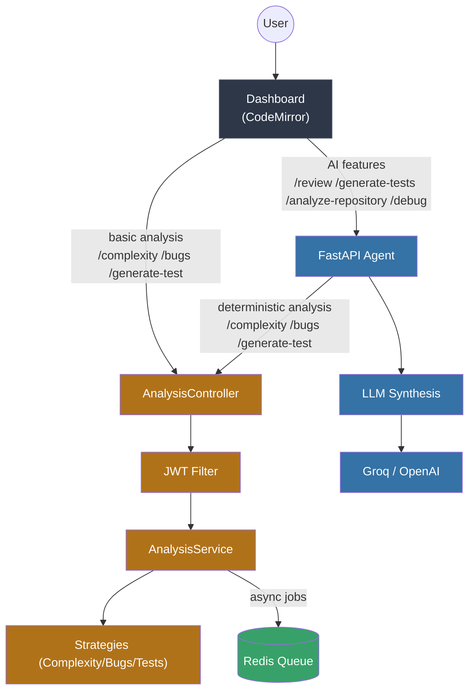

# Architecture

CodeCritic is split into two services connected over HTTP: a **Java analysis engine** and a **Python LLM orchestrator**. This split keeps deterministic analysis on the JVM (where JavaParser and our pattern detector live) and AI orchestration in Python (where the LLM ecosystem is strongest).

## Services

| Service | Stack | Responsibility |
|---------|-------|----------------|
| `java-server` | Spring Boot 3, Java 21, JavaParser, jjwt | Deterministic analysis: complexity, bug detection, JUnit scaffolds; auth; optional Redis-backed async jobs |
| `python-agent` | FastAPI, Pydantic, httpx | Orchestrates the Java service, then synthesizes reviews/test-suites via an LLM (Groq primary, OpenAI fallback) |

## Control flow



The dashboard (served by Java at port 8080) calls **both** services directly from the browser:

- **Java directly** for deterministic analysis (`/api/complexity`, `/api/bugs`, `/api/generate-test`) and auth/config
- **Python directly** for AI-powered features (`/review`, `/generate-tests`, `/analyze-repository`, `/debug`)

The Python agent then calls back into the Java server for the underlying deterministic analysis, combining those results with LLM synthesis before returning to the browser.

## Java layer (the analysis engine)

The controller layer only talks to `AnalysisService`, a thin facade:

- `AnalysisServiceImpl` delegates each concern:
  - Complexity → `ComplexityAnalyzer` (Strategy)
  - Bugs → `BugDetector` (Composite of pattern + cached SpotBugs)
  - Tests → `TestGenerator` (Strategy)
  - Jobs → `JobCoordinator` (Adapter over SimplyDone4J, wrapped by a resilient decorator)

New analysis types are added by implementing the relevant interface — `ComplexityAnalyzer`, `BugDetector` or `TestGenerator` — as a Spring `@Component` and injecting it where needed; the wiring is ordinary constructor injection (Open/Closed Principle).

### Thread-safety & concurrency

- **SpotBugs isolation**: each run writes to a fresh `UUID` temp directory (`SpotBugsRunner`), preventing collisions under parallel reviews. The `spotbugs` CLI and `javac` are installed in the Docker image, enabling full SpotBugs analysis alongside the pattern detector.
- **SpotBugs cache**: `CachedSpotBugsBugDetector` keys results by SHA-256 of source + detector version. It is a synchronized, access-ordered `LinkedHashMap` bounded to 256 entries with LRU eviction, so repeated analysis of identical code skips recompilation without unbounded memory growth.

### Idempotent async jobs

`SimplyDoneJobCoordinator.sha256Hex(jobType, payload)` derives a deterministic idempotency key by hashing the job type plus a **canonical JSON encoding of the full payload**: the payload is serialized with an `ObjectMapper` configured with `SORT_PROPERTIES_ALPHABETICALLY` and `ORDER_MAP_ENTRIES_BY_KEYS`, so map keys are sorted at *every* nesting level while list order is preserved (list order is part of a job's identity). Identical submissions therefore always produce the same key regardless of map iteration order, and structurally different payloads cannot collide — the old flat `key=value` concatenation let `{a="1b=2"}` and `{a="1", b="2"}` fold into the same pre-hash string. Retrying the same submission returns the same key, so SimplyDone4J does not create duplicate work.

Two failure modes deliberately do **not** fall back to a weaker key: a payload that cannot be canonically serialized (`IllegalStateException`), and a JVM without SHA-256 (`IllegalStateException`). Substituting a lossy key would silently merge distinct jobs, which is exactly the collision the canonical form exists to prevent.

The producer passed to the queue is the originating identity qualified by the job type (e.g. `alice-complexity-analysis`), so SimplyDone4J's per-producer rate limiter is not shared across unrelated job types from the same user. Idempotency still holds because the same user + job type + content yields the same producer + key.

Handlers are registered with the library at startup by `SimplyDoneHandlerRegistrar`; SimplyDone4J dispatches queued jobs only through its `HandlerRegistry`, so job types with no registered handler are rejected with "No handler registered".

**Graceful degradation.** `ResilientJobCoordinator` is the `@Primary` `JobCoordinator`. If the queue backend is unavailable (Redis/Mongo down) it catches the failure and runs the job on a bounded `ThreadPoolExecutor` (core 2 / max 4 / queue 50, mirroring `simplydone4j.executor`), retaining results in a synchronized LRU capped at 256 entries with a 5-minute TTL — so the submit → poll contract still resolves. Deliberate load-shedding signals (`RateLimitExceededException`, `QueueFullException`) are **not** downgraded to local execution; they propagate so the caller can answer `429`/`503`. Job status reads distinguish a genuinely unknown id (`JobNotFoundException` → `null` → `404`) from an infrastructure fault (propagated → `5xx`), and terminal statuses the UI cannot render (`DLQ`, `CANCELLED`) are reported as `FAILEDWithError` so the poller stops instead of spinning.

## Python layer (the orchestrator)

`agent.py` provides typed HTTP wrappers (`get_complexity`, `find_bugs`, `generate_test`) that keep the Java calls mockable, plus the orchestration pipelines:

- `run_review_pipeline` — deterministic analysis (complexity, bug findings, JUnit scaffolds) → a single-call LLM synthesis of the review (the frontend already requests the full AI test suite separately via `/generate-tests`, so it is not regenerated here)
- `generate_full_test_suite` — JUnit suite with real assertions using findings as context
- `analyze_github_repository` — clone via codeload/API, per-file analysis, deterministic repo metrics, then LLM summary
- `analyze_debug_issue` — source + error log + static findings → root-cause diagnosis

`groq_llm.py` wraps LLM providers with retry (tenacity) on transient failures (network, 429, 5xx) and provider fallback. Provider-specific parsing is isolated here so the rest of the agent stays provider-agnostic.

## Observability

- Both services emit **structured JSON logs** (Java via `logstash-logback-encoder`, Python via `python-json-logger`). The Python agent attaches a per-request id; the Java server does **not** yet propagate a correlation id across the queue lifecycle — see [known-limitations](known-limitations.md).
- `GET /api/metrics` (Java) reports analysis counts, per-type latency, and SpotBugs timing. The SpotBugs LRU cache tracks `hits()`/`misses()`/`size()` internally, but those are not yet exposed on this endpoint.
- `GET /metrics` (Python) reports request counts, status codes, and latency percentiles.

## Repository layout

```
java-server/src/main/java/com/codecritic/
  analysis/          Analyzer/detector/generator interfaces + impl/
  config/            WebSecurityConfig, JwtProperties, RedisConfig, SimplyDone4J wiring, DefaultUserInitializer
  controller/        AnalysisController, AuthController, ConfigController, FrontendController, HealthController
  dto/               Transport records
  exception/         Global error handling
  job/               JobCoordinator adapter over SimplyDone4J + resilient fallback decorator
  metrics/           AnalysisMetrics registry
  model/ repository/ User entity + repository
  security/          JWT provider + auth filter
  service/           AnalysisService + AuthService facades
python-agent/
  app.py             FastAPI surface (CORS, rate limit, payload limits)
  agent.py           Tool wrappers + orchestration pipelines
  groq_llm.py        LLM provider wrapper (retry + fallback)
```